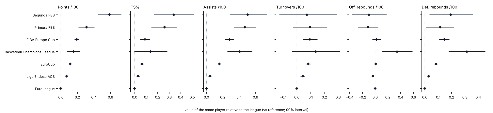

# league-translator

What would this player's numbers look like in another competition? The translator puts the
ACB, EuroLeague, EuroCup, FIBA competitions and the Spanish FEB leagues on one scale, from the
players who played in more than one of them, and projects any player into any of them with an
interval.

It reads the game tables of [hoops-warehouse](https://github.com/alvaro-bustamante/hoops-warehouse)
(`<competition>_<season>_player_games.csv`), found next to this project or in `HOOPS_WAREHOUSE`.

```bash
pip install -r requirements.txt
python -m translator.cli fit                       # v1: every pair of competitions
python -m translator.cli fit --model bayes         # v2: one joint Bayesian model (numpy, ~2 min)
python -m translator.cli translate --model bayes --player "Shermadini" --from acb --season 2025 --to euroleague
streamlit run app.py                               # the app (Spanish / English)
```

## How it works

Every statistic is first expressed **relative to its league-season** (log ratio for rates per 100
possessions, logit difference for percentages, difference for PIR and +/-), so that the era and
the style of each league are taken out. The league effect is then learnt from the players who
played in two competitions.

### v1: pairwise random effects

For each pair of competitions, the change of the players who played in both (same season, or
consecutive seasons corrected by the usual year-to-year change) is pooled with a DerSimonian-Laird
random-effects model. Simple and transparent, but each pair is fitted alone: the factors are not
transitive, and a pair with few shared players gets no help from the others.

### v2: one hierarchical Bayesian model (`translator/bayes.py`)

For each metric, every player-season in every competition is one observation:

```
rel[player, competition, season] = theta[player, season] + lambda[competition]
                                   + beta · team strength + gamma[team-season] + noise

theta[player, season] = alpha[player] + eta[player, season]   season level, shared by every
                                                              competition he played that season
alpha[player] ~ Normal(m[group], tau_alpha)                   career level; group = the set of
                                                              competitions he played
eta ~ Normal(0, sigma) · gamma ~ Normal(0, tau_gamma) · noise variance known from his possessions
```

- **All competitions at once.** `lambda[b] − lambda[a]` is the translation from a to b, so the factors
  are transitive by construction, and a player who went ACB → EuroCup → EuroLeague informs all of
  them.
- **Talent is not the same everywhere.** The career level has a different mean for each group of
  competitions, so the league effect comes only from the players who moved or played two
  competitions in the same season, not from the (meaningless) comparison of league averages.
- **Team strength is separated from the league.** Team strength is the net rating of the team in
  its league-season, in standard deviations. This matters: Real Madrid or Barcelona are dominant in
  the ACB and average in the EuroLeague, and a pairwise comparison mixes that change of standing
  into the league effect. In v2 the league effect is *at equal team standing*, and a projection can
  ask for a strong or a weak new team (`--team-z`).
- **Two backends.** A blocked Gibbs sampler in numpy (every step conjugate; the season terms are
  integrated out when the player level is drawn, and exact moves along the directions that only the
  movers inform keep the chains mixing), and the same model in **PyMC** (`--backend pymc`, NUTS) to
  check or extend it. The Gibbs sampler is tested on simulated careers with known effects
  (`tests/test_bayes.py`).

Competitions not linked to the reference by at least five shared players are left out and
reported (for now the NBA: its play-by-play names are abbreviated and do not match the European
ones).

## Results (v2, seasons 2016-17 to 2026-27)



The same player, on a team of the same standing, compared with the EuroLeague:

| Competition | Points /100 | TS% (logit) | Assists /100 | Shared players |
|---|---|---|---|---|
| Liga Endesa ACB | ×1.07 | +0.03 | ×1.04 | 685 |
| EuroCup | ×1.12 | +0.06 | ×1.17 | 760 |
| Basketball Champions League | ×1.17 | +0.14 | ×1.50 | 11 |
| FIBA Europe Cup | ×1.21 | +0.09 | ×1.32 | 145 |
| Primera FEB | ×1.36 | +0.26 | ×1.60 | 36 |
| Segunda FEB | ×1.80 | +0.34 | ×1.66 | 19 |

- The ladder is the expected one, and the ACB is the closest competition to the EuroLeague: a
  player scores about 7% more per possession in the ACB than he would in the EuroLeague, 12% more
  in the EuroCup and over a third more in Primera FEB.
- **Team strength mostly moves efficiency and turnovers, not volume:** one SD of team strength is
  worth +0.05 on the logit of TS% (about +1.3 points of TS%) and 5% fewer turnovers, but almost
  nothing in points or assists per 100.
- **Plus-minus is almost all team:** between-player spread of +/- per 100 is tiny once team
  strength (7 points per SD) and team effects are in the model. It is reported, but it is not a
  player metric.
- The BCL and the FEB leagues rest on few shared players (and on the seasons collected so far), so
  their intervals are wide; they will narrow as more seasons enter the warehouse.

## Limits

- The movers are not a random sample (who moves, and why, is a decision), and the model assumes
  that the league effect is the same for every player; a player-by-league interaction is the next
  step.
- The projection is for the player's underlying rate, not for the box score of a single season:
  the interval includes the uncertainty of his level and of the league effect and an unknown new
  team context, not game-to-game luck.
- Next-season projections use the career level plus a new season-to-season change; there is no
  age curve yet.

Data: ACB, Euroleague Basketball, FIBA, FEB (through hoops-warehouse; no raw tables are
published here). Code: MIT. Author: Álvaro Bustamante-Sánchez, PhD, Head of the Applied
Technology & Research Lab.
